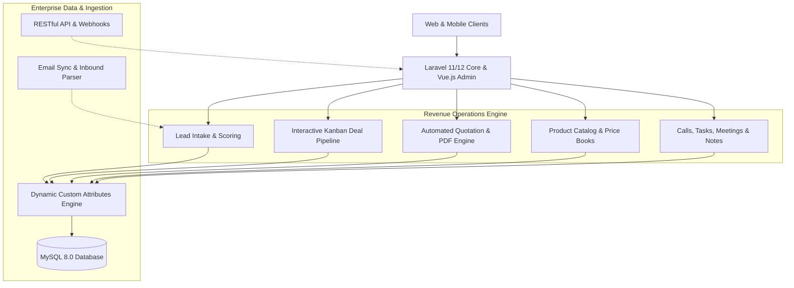

<p align="center">
  
</p>

<h1 align="center">AldebaranCRM</h1>
<h3 align="center">Enterprise Sales Pipeline Intelligence & Quotation Engine</h3>

<p align="center">
  <strong>The Red Giant Star of Autonomous Deal Execution & Revenue Operations</strong><br />
  Production-Grade, Zero-Per-Seat Alternative to Salesforce & HubSpot for Agencies & Mid-Market Enterprises
</p>

<p align="center">
  <a href="https://github.com/wtfear"></a>
  <a href="https://github.com/wtfear/AldebaranCRM/actions"></a>
  <a href="./LICENSE"></a>
  <a href="https://laravel.com"></a>
  <a href="https://vuejs.org"></a>
  <a href="https://www.mysql.com"></a>
</p>

---

## 🌟 Executive Overview

**AldebaranCRM** (named after Alpha Tauri, the fiery red giant star known as the *Eye of Taurus* and *The Follower*) is an MIT-licensed, enterprise-grade Customer Relationship Management and revenue operations platform built on **Laravel and Vue.js**.

While mid-market enterprises routinely hemorrhage \$50,000 to \$300,000+ annually on rigid SaaS per-seat taxes (Salesforce, HubSpot, Microsoft Dynamics), AldebaranCRM delivers **100% operational ownership with zero per-seat fees**. It features visual deal pipelines, automated multi-currency quotation generation, an extensible EAV attribute model, email synchronisation, and AI lead parsing.

---

## 🏛️ Architecture & Operational Capabilities



### 1. 🎯 Dynamic Visual Sales Pipeline
- **Kanban Deal Stages:** Drag-and-drop lead progression with weighted pipeline forecasting and win-probability calculation.
- **Custom Stage Progression:** Enforce stage gate validations (e.g., discovery calls must be logged before generating quotes).
- **Activity Timeline:** Complete chronological audit log of all client interactions, emails, attachments, and call notes.

### 2. 📑 Automated Quotation & Invoicing
- **Multi-Currency Price Books:** Instant quote generation tied directly to your inventory product catalog.
- **PDF Generation Engine:** Automated branded quotation PDFs delivered to prospects with one click.
- **Tax Regimes & Discounts:** Configurable multi-tier tax rates, percentage/fixed discounts, and payment terms.

### 3. 🧩 Infinite Custom Attributes (EAV Engine)
- Add custom fields to Leads, Persons, Organizations, Products, and Quotes directly from the admin UI without database migrations.
- Supports text, numeric, date, select, multiselect, file uploads, and relationship lookups out-of-the-box.

### 4. 📬 Omnichannel Ingestion & Webhooks
- Ingest leads from web forms, WhatsApp, email threads, and third-party APIs via high-throughput webhooks.
- Inbound email parsing connects directly to IMAP/SendGrid to thread prospect replies automatically to deal cards.

---

## 🚀 Quick Start (Local Docker)

Launch the full AldebaranCRM platform with containerized MySQL in under 60 seconds:

```bash
# 1. Clone the repository
git clone https://github.com/wtfear/AldebaranCRM.git
cd AldebaranCRM

# 2. Start the containerized application stack
docker compose up -d

# 3. Access the sales cockpit
open http://localhost:8000/admin/login
```

Default Administrative Credentials:
- **Cockpit URL:** `http://localhost:8000/admin/login`
- **Default Email:** `admin@example.com`
- **Default Password:** `admin123`

---

## ☁️ Cloud Deployment Options

| Cloud Platform | Method | Tier | Configuration File |
|---|---|---|:---:|
| **Render** | Docker Web Service + Managed MySQL | Free / Starter | [`render.yaml`](./render.yaml) |
| **Railway** | Docker Container Auto-Deploy | Hobby / Pro | [`Dockerfile`](./Dockerfile) |
| **AWS / GCP VPS** | Docker Compose + Nginx/Traefik | \$10–\$20/mo | [`docker-compose.yml`](./docker-compose.yml) |

---

## 🌌 The WTFear Celestial Enterprise Portfolio

AldebaranCRM forms the revenue pipeline cornerstone of the **WTFear Celestial AI Suite**:

| Star | Flagship Platform | Category | Stack |
|---|---|---|---|
| 🌟 **Aldebaran** | **`AldebaranCRM`** | Enterprise Sales Pipeline & Quotation CRM | Laravel, Vue.js, MySQL |
| 🌟 **Polaris** | **`PolarisERP`** | Autonomous Enterprise ERP, CRM & WMS | Next.js 15, PostgreSQL, TurboRepo |
| 🌟 **Sirius** | **`SiriusIQ`** | Enterprise Workplace Knowledge OS & RAG | Next.js, FastAPI, Vespa, PostgreSQL |
| 🌟 **Capella** | **`CapellaBI`** | BI-as-Code & Unit Economics Cockpit | DuckDB-WASM, Svelte, SQL |
| 🌟 **Altair** | **`AltairCommerce`** | Headless B2B/D2C Commerce Engine | Node.js, Next.js, Redis, PostgreSQL |
| 🌟 **Vega** | **`VegaDocs`** | Air-Gapped Document Intelligence & RAG | React, Node.js, Vector DBs |
| 🌟 **Arcturus** | **`ArcturusFlow`** | Visual Agentic Workflow & Multi-Agent Builder | Python, React, FastAPI, MCP |

---

## 📄 License & Attribution

- **Core Framework License:** [MIT License](./LICENSE) — 100% Free for commercial, agency, and client white-label deployments.
- **Upstream Engine:** Built on the battle-tested [Krayin CRM](https://krayincrm.com) core.
- **Maintained & Enhanced by:** [WTFear Agency](https://github.com/wtfear) & **Pavan Kumar Kunukuntla**.
